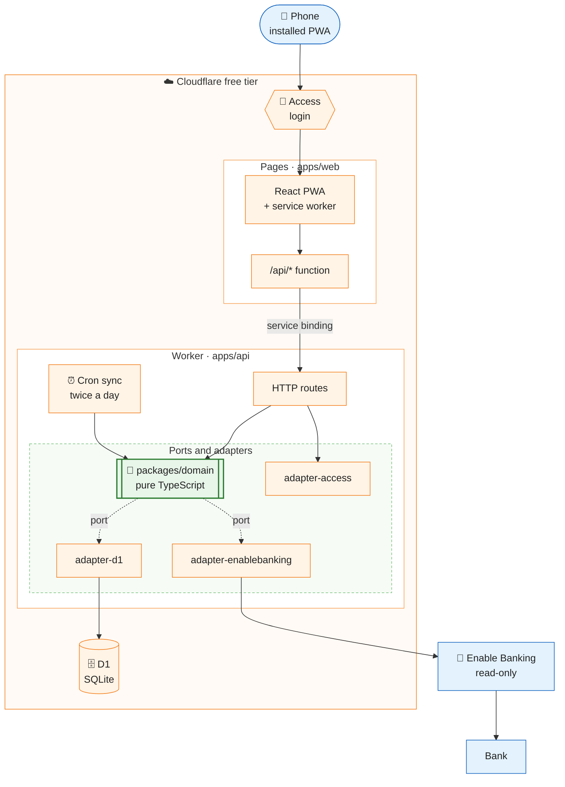

# Kronkoll

[](https://github.com/johanpearson/kronkoll/actions/workflows/ci.yml?query=branch%3Amain)
[](https://github.com/johanpearson/kronkoll/actions/workflows/deploy.yml)
[](https://github.com/johanpearson/kronkoll/actions/workflows/mutation-nightly.yml)
[](https://github.com/johanpearson/kronkoll/actions/workflows/contract-enable-banking.yml)


[](LICENSE)

A personal budget app for one household. It reads transactions from the bank, sorts them into
categories and shows where the money went this month. The interface is in Swedish and all amounts are in SEK.

## What it does

- Connects to the bank through [Enable Banking](https://enablebanking.com/) with **read-only** access. There is no code for payments.
- Syncs transactions, removes duplicates and categorises them with rules you teach it.
- Shows a monthly overview and budget per category, and works as an installable app on the phone.

## How it is built



The business rules live in `packages/domain` without any dependencies. Cloudflare, the database and the bank
are reached only through adapters, so the core can be tested on its own. The API Worker has no public address:
it is reached only from Pages, after Cloudflare Access has checked the login.

## Quality

Every pull request must pass the `ci-ok` gate before it can be merged, and only a green `main` is deployed.
The gate runs secret scanning, lint, type checks, architecture rules, unit tests with at least 90 % coverage,
mutation tests of the domain (at least 85 %), integration tests in the Workers runtime, and end-to-end tests
on a phone viewport with accessibility and Lighthouse checks.

Each night a full mutation run checks the domain, and a contract test runs against the bank's sandbox.

## Run it locally

Requires Node 22 (see `.nvmrc`) and pnpm via Corepack.

```bash
corepack enable
pnpm install
pnpm lint && pnpm typecheck && pnpm architecture
pnpm --filter @kronkoll/domain test:coverage
```

## More

- Requirements and plan: [`plans/kronkoll`](plans/kronkoll) (open `plan.html` for a clickable version)
- Working rules for people and AI agents: [AGENTS.md](AGENTS.md) (Swedish)
- Privacy and terms (Swedish): [docs/privacy.md](docs/privacy.md), [docs/terms.md](docs/terms.md)

## License

[MIT](LICENSE)
